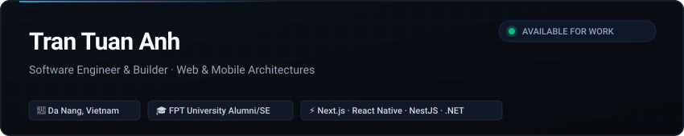

  

  <a href="https://trantuananhdev.vercel.app"><b>Portfolio Website ↗</b></a> &nbsp;&bull;&nbsp;
  <a href="https://www.facebook.com/tran.tuananh.615673"><b>Facebook ↗</b></a> &nbsp;&bull;&nbsp;
  <a href="mailto:xmy283480@gmail.com"><b>xmy283480@gmail.com ↗</b></a>

---

### About

Software Engineer based in Da Nang, Vietnam. Focused on **Web & Mobile Application Development**, system architecture, and building tools with high type-safety and clean code conventions. 

- Experienced in taking software from initial requirements engineering (SRS) down to production deployment and automated testing.
- Strong affinity for **TypeScript**, **Next.js**, **React Native**, **NestJS**, and **ASP.NET Core**.

---

### Featured Works

#### [FlintFlow](https://github.com/TuanAnh164) — Software Requirements Specification & Documentation Platform
A platform designed to clarify ambiguous project ideas and compile structured **IEEE 830 SRS documents**.
- Implemented structured Chat-to-Document refinement workflows and single-source-of-truth requirement models.
- Automated technical diagram generation and multi-phase document exports.
- **Tech Stack:** `TypeScript` · `Next.js 15` · `Node.js` · `Express` · `MongoDB` · `Vitest` · `Playwright`

#### [MergeTrack](https://github.com/TuanAnh164) — Pull Request Static Code Quality Analyzer
An automated static analysis system designed to catch code smells and maintainability regressions in React/Next.js Pull Requests.
- Utilizes Babel AST parsing to evaluate syntax patterns against maintainability rules.
- Integrates directly into developer workflows via a custom GitHub Action paired with a Next.js SaaS dashboard.
- **Tech Stack:** `TypeScript Monorepo` · `AST Engine` · `Next.js` · `GitHub Actions` · `Tailwind CSS`

#### [HabitFlow](https://github.com/TuanAnh164) — Cross-Platform Mobile Habit Tracker
A mobile application for daily routine tracking, habit scheduling, and streak consistency.
- Features offline-capable habit logging, real-time sync, and fluid navigation powered by Expo Router.
- Built on top of a modular NestJS backend with JWT authentication and optimized MongoDB queries.
- **Tech Stack:** `React Native` · `Expo Router` · `NestJS` · `MongoDB` · `TanStack Query`

#### [Kul LMS](https://github.com/TuanAnh164) — Educational & Learning Management System
An academic management platform supporting student schedules, attendance verification, assignments, and test assessments.
- Architected with a multi-tier ASP.NET Core Web API with strict relational constraints and role-based permissions.
- Integrated with an interactive React interface featuring drag-and-drop schedule management and automated grading.
- **Tech Stack:** `ASP.NET Core (C#)` · `Entity Framework Core` · `React` · `Redux Toolkit` · `SQL Server`

---

### Technical Capabilities

| Layer | Technologies & Tools |
| :--- | :--- |
| **Languages** | `TypeScript` · `JavaScript` · `C#` · `Java` · `HTML5` · `CSS3` |
| **Frontend & UI** | `Next.js` · `React` · `Tailwind CSS` · `Redux Toolkit` · `Vite` |
| **Mobile** | `React Native` · `Expo Router` |
| **Backend & APIs** | `Node.js` · `NestJS` · `Express.js` · `ASP.NET Core Web API` |
| **Databases** | `MongoDB (Mongoose)` · `Microsoft SQL Server (EF Core)` |
| **Testing & CI/CD** | `Vitest` · `Playwright E2E` · `Selenium WebDriver` · `GitHub Actions` |
| **Engineering Tools** | `Git` · `Postman` · `Jira` · `Figma` · `Visual Paradigm` |

---

  Crafted with focus on simplicity &bull; Tran Tuan Anh &bull; 2026

